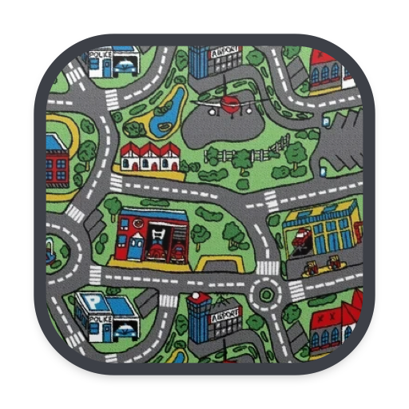
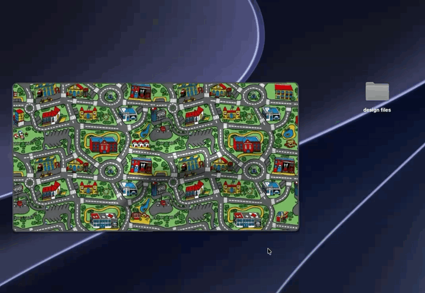

<p align="center">
  
</p>

<h1 align="center">Road Rug</h1>

<p align="center">
  A physics rug for your Mac desktop. Sweep your mess under it.
  <br>
  <a href="https://github.com/Augustas-Armalis/road-rug/releases/latest/download/RoadRug.zip"><b>Download for macOS</b></a>
  ·
  <a href="docs/demo.mp4">Watch the demo</a>
</p>

<p align="center">
  
</p>

Road Rug puts a kids' city-roads play mat on your desktop, right above your icons and below every window. It's a real cloth simulation: grab it, drag it around, peel up a corner, fold it over. Drop files onto it and they're swept underneath, leaving little lumps in the rug. Bigger files make bigger lumps.

## Features

- **Real cloth physics:** a heavy, thick rug that drapes, folds over itself and settles flat. It runs on Metal at your display's refresh rate, then sleeps when still (around 1% CPU idle).
- **Sweep files under the rug:** drag anything from your desktop onto the rug and it disappears underneath. It's moved into a hidden folder, not deleted.
- **Lumps:** everything hidden under the rug makes a soft bump, sized by how big it is.
- **Get things back:** lift a corner or slide the rug away to uncover your files, then drag them back to the desktop or double-click to open.
- **Stays out of the way:** clicks pass straight through to your desktop everywhere the rug isn't.
- **Remembers everything:** the rug's position and what's under it survive restarts.

## Install

1. [Download `RoadRug.zip`](https://github.com/Augustas-Armalis/road-rug/releases/latest/download/RoadRug.zip) and unzip it.
2. Move **Road Rug.app** into your Applications folder.
3. The app isn't notarized, so macOS blocks the first launch. Either right-click the app and choose **Open**, or run:

   ```bash
   xattr -dr com.apple.quarantine "/Applications/Road Rug.app"
   ```

4. Open it. The rug drops onto your desktop, and a small rug icon appears in the menu bar.

Requires macOS 14 Sonoma or later, on Apple Silicon or Intel.

## How to use it

| Do this | To |
| --- | --- |
| Drag the middle of the rug | Slide the whole rug around |
| Drag a corner or edge | Lift it and fold it over |
| Hold <kbd>⌥</kbd> and drag anywhere | Lift from that spot |
| Two-finger rotate on the trackpad | Twist the rug |
| Drop files from the desktop onto it | Sweep them under the rug |
| Drag an uncovered item off the rug | Put it back on your desktop |
| Double-click the rug | Lay it flat again |
| Right-click the rug, or the menu-bar icon | Straighten, recenter, show what's hidden, put everything back, quit |

Swept items live in `~/Library/Application Support/Road Rug/Under the Rug`. **Put Everything Back on Desktop** in the menu returns them all at once.

## Build from source

You only need the Xcode Command Line Tools (`xcode-select --install`), not the full Xcode.

```bash
git clone https://github.com/Augustas-Armalis/road-rug.git
cd road-rug
./build.sh
open "build/Road Rug.app"
```

`./build.sh --zip` also packages `dist/RoadRug.zip`, a universal build for Apple Silicon and Intel.

### How it works

- **`Sources/Cloth.swift`:** a position-based dynamics cloth (49 × 26 particles) with stretch, shear and bending constraints. It adds Coulomb friction against the desktop, contact between folded layers, and a floor height field for the lumps.
- **`Sources/RugView.swift`:** a transparent, click-through Metal view in a borderless window just above the desktop icons. It renders the rug as a thick sheet (printed pile, felt backing, bound edge with rounded corners) plus a soft shadow. It also handles the mouse, drag and drop, and saving state.
- **`Sources/RugTexture.swift`:** loads the rug texture and draws icons for the files hidden under the rug.

`RoadRug --snapshot <folder>` runs a scripted, headless scene: settling over lumps, folding a corner, then dragging. It writes PNG frames, which is handy for checking physics or rendering changes. To regenerate the app icon from the texture, run `swift scripts/make-icon.swift`.

### Making a demo

`scripts/demo-mess.sh` fills your desktop with about 40 realistic junk files to sweep under the rug on camera. `scripts/demo-clean.sh` moves exactly those files to the Trash afterwards, even if they're under the rug.

## Uninstall

Quit Road Rug from its menu, choosing **Put Everything Back on Desktop** first if anything is still under the rug. Then delete the app and `~/Library/Application Support/Road Rug`.

## Credits

Made by [Augustas Armalis](https://github.com/Augustas-Armalis).
Inspired by Terkel Gjervig's "Desktop Cleaning" idea of a rug for your desktop.

## License

The code is [MIT licensed](LICENSE). The rug artwork in `Resources/rug.png` is a city-roads play mat pattern and isn't covered by the MIT license.
